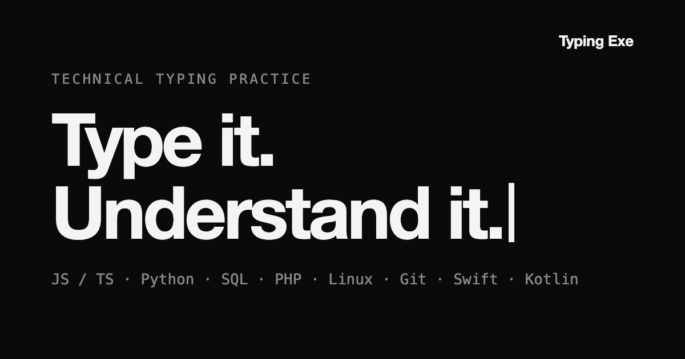

# Typing Exe

**Type real code. Understand it.**

Typing Exe is a typing trainer for programmers. Instead of random words, you type real code and commands, and a small bubble above the cursor explains what each line does as you reach it. You practice typing and learn the content at the same time.



## Features

- **Eight stacks:** JS / TS, Python, SQL, PHP, Linux (command line), Git, Swift and Kotlin.
- **Two levels:** Beginner and Pro, with 30 lessons in each stack and level (480 in total).
- **Explanations while you type:** each line has a short explanation, shown above the character you are typing. Lines you already typed keep theirs. Lines you have not reached show nothing.
- **Forgiving typing:** a wrong key turns red and you move on. Backspace fixes it. Nothing finishes until you press Enter.
- **Sector by sector:** each lesson is a "sector". When you finish one, its stats appear right under it, then the next sector opens in the same card. Scroll up inside the card to look back.
- **Report dialog:** "Stop & report" opens your WPM, accuracy, per-sector results and most-missed keys. Close it to carry on exactly where you were.
- **Fresh lessons every run:** a run draws a few lessons per stack, preferring ones you have not seen yet (remembered in your browser only).
- **Dark and light themes** that follow your system until you choose.
- **No backend, no accounts, no runtime AI.** All lessons are written and reviewed ahead of time and shipped as static data, so the site works as plain static files.

## Run it locally

You need Node.js 20.9 or newer.

```bash
npm install
npm run dev          # http://localhost:3000
```

| Command | What it does |
|---|---|
| `npm run dev` | Start the development server |
| `npm run build` | Build the static site into `out/` |
| `npm run start` | Serve the built `out/` folder locally |
| `npm run validate` | Check every lesson file (structure and code syntax) |
| `npm test` | Run the unit and component tests |
| `npm run check` | Validate, test and build in one go |

## How lessons work

Every lesson is one JSON file under `src/lessons/<stack>/`. Adding content never needs a code change: add a file, run `npm run validate`, and it appears in the app.

```json
{
  "id": "python-loop-01",
  "category": "Python",
  "topic": "Basics",
  "level": 1,
  "tags": ["loop", "print"],
  "chunks": [
    { "code": "rows = [\"a\", \"b\", \"c\"]", "explain": "A list called rows with three texts" },
    { "code": "for row in rows:", "explain": "Loop: repeat for every item in rows" },
    { "code": "    print(row)", "explain": "Show the current item" }
  ]
}
```

**Rules** (the validator enforces them):

- `id` is unique across all lessons, and the file is named `<id>.json`.
- `category` is the stack name (`Python`, `SQL`, `PHP`, `Linux`, `Git`, `Swift`, `Kotlin` or `JS / TS`).
- `level` is `1` (Beginner) or `2` (Pro).
- Each lesson has at most 10 `chunks` (3 to 8 is a good size). Each chunk's `code` is exactly one line.
- `explain` is plain English, at most 60 characters, and describes that one line.

**Style guidance** (not enforced by the validator): indent with spaces, never tabs; teach one idea per lesson; vary the example data between lessons.
- Lessons in the `JS / TS` stack also need `"lang": "js"` or `"lang": "ts"`.

**Code checks.** `npm run validate` also checks that the code is valid, using the real tools when they are installed:

| Stack | Check |
|---|---|
| Python | `ast.parse` |
| PHP | `php -l` |
| Linux | `bash -n` |
| SQL | run for real in an in-memory SQLite database that holds the sample tables from `scripts/sql-schema.sql` |
| Swift | `swiftc -typecheck` |
| JS | `node --check` |
| TS | `tsc --strict --noEmit` |
| Kotlin | `kotlinc` (skipped if it is not installed) |
| Git | no automatic check, so review commands by hand |

SQL lessons may use the sample tables in [`scripts/sql-schema.sql`](scripts/sql-schema.sql) without creating them. Write standard SQL that also runs on SQLite, and end the lesson with a semicolon.

A syntax check only proves the code is valid. It does not prove an explanation is correct, so every lesson still needs a human read.

## Project layout

```
src/
  app/            Next.js app: layout, page, SEO files (robots, sitemap, manifest)
  components/     Picker, SessionView, SectorCard, SectorInfo, Report, ThemeToggle
  lib/            typing engine, run/queue builder, report maths, theme, site config
  lessons/        all lesson data, one folder per stack
scripts/
  validate.mjs    the lesson validator
  sql-schema.sql  sample tables (customers, orders, ...) that every SQL lesson runs against
public/           icons, share image, film-grain texture
```

The typing engine ([`src/lib/engine.ts`](src/lib/engine.ts)) is plain TypeScript with no UI code, so it is easy to test.

## Deploy

The site is a Next.js static export (`output: "export"`), so any static host works. On Vercel, import the repository and accept the defaults. The canonical link, sitemap and share tags use your Vercel domain automatically.

For a custom domain, set this environment variable and redeploy:

```
NEXT_PUBLIC_SITE_URL=https://yourdomain.com
```

## Tech

Next.js, React, TypeScript, [Motion](https://motion.dev) for the heading animation, and Vitest with Testing Library for tests.

## License

[MIT](LICENSE)
